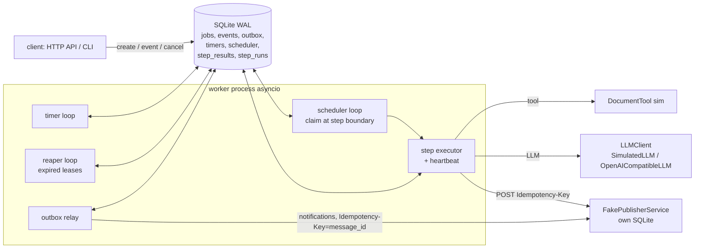
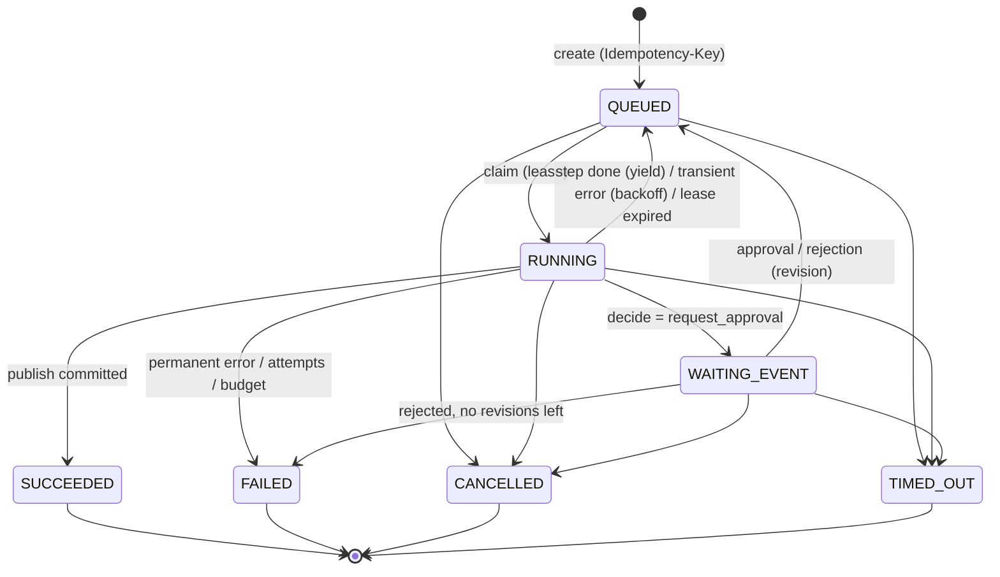

# agentrt — durable event-driven runtime для агента, готовящего отчёты

Собственный (вариант «Your choice») рантайм на **Python 3.11+ / asyncio** с **SQLite в режиме WAL**
как durable state store (таблицы `jobs`, `events`, `outbox`, `timers`, `scheduler`, `step_results`, `step_runs`),
HTTP API на **FastAPI** и CLI-обёрткой. Агент: `register job → fetch_documents (tool) → extract → draft (LLM)
→ decide (policy) → WAITING_EVENT (approval) → save_report → publish` во внешний `FakePublisherService`
(отдельный HTTP-процесс со своим SQLite), который дедуплицирует публикации по `Idempotency-Key`.

Результаты экспериментов и ответы на вопросы задания — в [REPORT.md](REPORT.md) / `REPORT.pdf`.

## Быстрый старт

Проверено: Windows 10 (PowerShell / Git Bash), Python 3.13.7 (`.python-version`); код требует ≥ 3.11.
Docker не нужен (есть опциональный `docker-compose.yml`).

```bash
python -m venv .venv
.venv/Scripts/python -m pip install -r requirements.txt      # Linux/macOS: .venv/bin/python
make test            # или: bash scripts/test.sh   | Windows: .\scripts\test.ps1
make exp-recovery    # Part 1   (scripts/exp_recovery.sh | .ps1)
make exp-events      # Part 2   (scripts/exp_events.sh   | .ps1)
make exp-load        # Part 3   (scripts/exp_load.sh     | .ps1)
make report          # графики + REPORT.md + REPORT.pdf из results/raw
bash scripts/run_all_experiments.sh   # всё с чистого состояния (Windows: .\scripts\run_all_experiments.ps1)
bash scripts/run_real_llm.sh          # прогон с РЕАЛЬНОЙ LLM (Windows: .\scripts\run_real_llm.ps1)
```

Запуск компонент вручную:

```bash
export PYTHONPATH=src
python -m agentrt.cli publisher --db pub.db --port 8765                     # внешний сервис
python -m agentrt.cli worker --db state.db --name w1 --publisher-url http://127.0.0.1:8765 [--llm real]
python -m agentrt.cli serve --db state.db --port 8000                        # HTTP API
curl -X POST localhost:8000/jobs -H 'Idempotency-Key: k1' -H 'content-type: application/json' -d '{"tenant_id":"t1"}'
python -m agentrt.cli status --db state.db <job_id>
python -m agentrt.cli event  --db state.db <job_id> --type approval --decision approve   # approval_id берётся из job
python -m agentrt.cli cancel --db state.db <job_id>
```

### Воспроизведение сбоев, дублей событий и нагрузки

| что | команда (Windows; для Linux/macOS — `scripts/*.sh`) |
|---|---|
| ручное демо в отдельных процессах: дубль создания по ключу → kill воркера посреди job → автоматическое возобновление → дубль approval с тем же `event_id` → позднее событие и cancel после терминала → 1 логическая публикация | `.\scripts\demo_manual.ps1` (только PowerShell) |
| все сценарии Part 1 (kill между шагами, kill во время LLM, крэш после publish, потерянный ack, повторяющаяся transient-ошибка) | `.\scripts\exp_recovery.ps1`; один сценарий, не трогая отчётные данные: `python -m experiments.exp_recovery --cases s1_kill_between_steps --reps 1 --out results/work/try` |
| E1–E7 Part 2 (в т.ч. E3 — дубли событий, E5 — гонки) | `.\scripts\exp_events.ps1` |
| нагрузка Part 3, 3 политики × 3 seed | `.\scripts\exp_load.ps1` |
| вручную отправить одно и то же событие дважды | `python -m agentrt.cli event --db state.db <job_id> --event-id evt-1` (повторить) → второй ответ `"outcome": "duplicate"` |

Реальная LLM: `OPENAI_API_KEY`, `OPENAI_BASE_URL`, `MODEL` (см. `.env.example`; `.env` в `.gitignore`).
Для Ollama: `OPENAI_BASE_URL=http://localhost:11434/v1 OPENAI_API_KEY=ollama MODEL=llama3.1`.
Опционально `LLM_REASONING_EFFORT` (например, `none`) — передаётся в запрос как `reasoning_effort`; для
«рассуждающих» моделей (qwen3.x в Ollama) без него ответ может прийти с пустым `content`. Запросы идут с `temperature = 0`.

Отчётные прогоны с реальной LLM (результаты лежат отдельно и не смешиваются с симуляцией):

```powershell
# 1) локально, Ollama (CPU): в .env MODEL=qwen3.5:4b, OPENAI_BASE_URL=http://localhost:11434/v1, LLM_REASONING_EFFORT=none
.\scripts\run_real_llm.ps1                                  # -> results/real_llm/
# 2) сервер университета (vLLM, нужен VPN): в .env MODEL=qwen3.8-27b, OPENAI_BASE_URL=<адрес сервера>/v1,
#    OPENAI_API_KEY=<выданный токен>, PRICE_PER_1K_PROMPT=0, PRICE_PER_1K_COMPLETION=0
.\scripts\run_real_llm.ps1 --out results/real_llm_server   # -> results/real_llm_server/
```
Оба скрипта в конце пересобирают REPORT.md/PDF.

## Почему свой рантайм, а не Temporal / FastStream

| | Temporal | FastStream (+Kafka/RabbitMQ) | agentrt (этот репозиторий) |
|---|---|---|---|
| durable state | event history в кластере Temporal | нет — только доставка сообщений, состояние надо хранить самому | строки `jobs`/`step_results` в SQLite, изменяемые транзакциями |
| redelivery | встроено (activity timeouts, heartbeats) | ack/nack брокера | lease + heartbeat + visibility timeout (`lease_expires_at`) |
| таймеры | встроены | нет | таблица `timers`, переживает рестарт |
| инфраструктура | кластер (server + DB), SDK с ограничениями детерминизма workflow-кода | брокер | один файл SQLite, ноль сервисов |

Задание требует *показать*, как обеспечиваются durable state, redelivery, recovery и workload control, и
измерить их. В Temporal эти механизмы скрыты в платформе (их нельзя изменить, например вставить
своё DRR-планирование по tenant на границах шагов или CAS-приоритеты отмены). FastStream решает только
транспорт: состояние, дедуп, таймеры и outbox всё равно пришлось бы писать. SQLite даёт ACID-транзакции и
сериализацию писателей «бесплатно», а вся логика гарантий лежит в ~2200 строках кода (`src/agentrt`), которые можно
прочитать и протестировать. Цена — один узел (single-writer), см. «Ограничения» в REPORT.md.

## Архитектура



* **Store** (`src/agentrt/store.py`): все изменения состояния — `BEGIN IMMEDIATE` транзакции с
  compare-and-set по `version`. Каждая транзакция атомарно пишет: новое состояние + результат шага
  (`step_results`) + сообщение outbox + след исполнения (`step_runs`).
* **Worker** (`worker.py`): исполняет ровно **один шаг** за захват (lease), затем отпускает задачу обратно
  в очередь (`RUNNING → QUEUED`) — планирование происходит на границах шагов.
* **Agent** (`agent.py`): шаги и политика решения; каждый шаг читает входы только из `step_results`.
* **Scheduler** (`scheduler.py`): FIFO или DRR (deficit round robin по tenant) + aging приоритетов.
* **FakePublisherService** (`publisher.py`): отдельный процесс/HTTP-эндпоинт с собственной БД.

### Модель данных (основное)

| таблица | назначение |
|---|---|
| `jobs` | состояние, `version` (CAS), `next_step`, `attempt`, lease (`lease_owner`, `lease_token`, `lease_expires_at`), `run_after` (backoff), `deadline`, лимиты, счётчики |
| `transitions` | журнал переходов; пишется **триггером** при любом изменении `state` |
| `allowed_transitions` | таблица допустимых переходов; триггер отклоняет остальные |
| `step_results` | чекпоинты шагов, PK `(job_id, step_key)` |
| `step_runs` | трасса исполнения: каждая попытка шага; открытые строки = занятые слоты |
| `events`, `event_receipts` | inbox внешних событий (PK `event_id` = дедуп) и все получения, включая дубли |
| `outbox` | transactional outbox (уведомления `approval.requested`, `job.<terminal>`) |
| `timers` | durable дедлайны |
| `scheduler`, `scheduler_meta` | состояние DRR (deficit, вес, указатель round-robin) |
| `rejections`, `counters`, `compensations`, `workers` | метрики и служебное |

## Job

Поля: `job_id`, `tenant_id`, `idempotency_key` (уникальный индекс `(tenant_id, idempotency_key)`),
`created_at`, `deadline`, `priority`, `job_class` (`short`/`long`), `params`, `limits`.

| лимит (`JobLimits`) | дефолт | смысл |
|---|---|---|
| `max_steps` | 30 | максимум исполненных шагов (включая tool-loop и ревизии) |
| `max_tokens` | 20 000 | бюджет токенов LLM на job (проверяется перед каждым вызовом) |
| `max_attempts` | 4 | попыток на шаг; потеря lease (крэш воркера) тоже считается попыткой |
| `step_timeout_s` | 30 | таймаут одной попытки шага (вирт. секунды) |
| `deadline_s` | 600 | дедлайн job от `created_at`; действует в очереди, при исполнении и в ожидании |
| `max_tool_calls` | 3 | сколько раз политика может дозапросить документы |
| `max_revisions` | 1 | сколько раз отклонённый черновик может быть переписан |

Параметры: `require_approval` (по умолчанию `true`), `min_docs`, `collection_id`, `topic`, `max_output_tokens`.

## Event

```json
{"event_id": "evt-123", "type": "approval", "payload": {"approval_id": "apr-…", "decision": "approve|reject", "comment": "…"}}
```
Типы: `approval`, `cancel`. Правила (`Store.submit_event`, одна транзакция):
1. `INSERT OR IGNORE INTO events` — если `event_id` уже есть → `duplicate`, состояние не меняется.
2. job терминальна → `ignored_terminal` (позднее событие, счётчик `events_late`).
3. job не в `WAITING_EVENT` → `ignored_state`; `approval_id` не совпадает с текущим → `ignored_stale_approval`.
4. дедлайн уже прошёл (даже если таймер ещё не сработал) → `TIMED_OUT` (`deadline_won`).
5. `approve` → `QUEUED` (следующий шаг `save_report`); `reject` → новая ревизия черновика (новый
   `approval_id`, старый становится stale) или `FAILED` при исчерпании `max_revisions`.
Каждое получение пишется в `event_receipts` и в JSON-лог с `event_id`.

## Состояния



| из \ в | QUEUED | RUNNING | WAITING_EVENT | SUCCEEDED | FAILED | CANCELLED | TIMED_OUT |
|---|---|---|---|---|---|---|---|
| QUEUED | – | ✔ claim | | | | ✔ | ✔ |
| RUNNING | ✔ yield/retry/recovery | – | ✔ | ✔ | ✔ | ✔ | ✔ |
| WAITING_EVENT | ✔ approval | | – | | ✔ reject | ✔ | ✔ |
| терминальные | ✘ | ✘ | ✘ | ✘ | ✘ | ✘ | ✘ |

Защита в SQL (`src/agentrt/db.py`): все переходы — `UPDATE jobs … WHERE job_id=? AND version=? AND state NOT IN
(терминальные)`; дополнительно триггеры `trg_terminal_immutable` (любой UPDATE терминальной строки →
`ABORT`), `trg_allowed_transition` (пара `(src,dst)` должна быть в `allowed_transitions`),
`trg_version_bump` (смена состояния без `version+1` запрещена), `trg_log_transition` (журнал).

## Гарантии и как они обеспечены

1. **Durable state.** Состояние job, результаты шагов, события, таймеры, outbox и состояние планировщика
   хранятся в SQLite (WAL). Подтверждённая транзакция переживает убийство процесса (SIGKILL/TerminateProcess).
   `synchronous=NORMAL`: при отключении питания можно потерять последние транзакции; `AGENTRT_SYNC=FULL` это убирает.
2. **Redelivery (lease / heartbeat / visibility timeout).** Захват шага ставит `lease_token` и
   `lease_expires_at = now + lease_timeout`. Heartbeat продлевает lease каждые `heartbeat_interval`. Если воркер
   умер — lease истекает и reaper любого воркера возвращает задачу в `QUEUED` (`attempt` растёт).
   Все записи результата фенсятся по `lease_token`: «зомби»-воркер не может закоммитить поздний результат.
3. **Recovery.** При старте воркер: (а) сразу забирает lease своих же прошлых инкарнаций (то же имя
   воркера ⇒ прежний процесс заведомо мёртв); (б) возвращает задачи с истёкшим lease; (в) срабатывает
   просроченные таймеры; (г) outbox-relay дошлёт недоставленные сообщения. Шаги с результатом в
   `step_results` не перевыполняются: следующий шаг определяется `next_step`, который коммитится вместе с результатом.
4. **Workload control.** `global_concurrency` и `per_tenant_concurrency` проверяются *внутри транзакции
   захвата* по числу открытых `step_runs` (поэтому верны и для нескольких процессов воркеров);
   `worker_concurrency` — локальная ёмкость процесса; `max_queue_size` (+ опц. `max_queue_per_tenant`) —
   admission control при создании: HTTP 429 `{"status":"REJECTED","reason":"queue_full"}`, запись в `rejections`.
   Ожидание approval (`WAITING_EVENT`) **не занимает слот**: у такой задачи нет открытого `step_run`.

### Retries
`TransientError` (таймаут шага, 429/5xx, обрыв соединения, потерянный ack, неизвестные исключения) →
повтор через очередь с `run_after = now + backoff`, backoff — экспонента с equal jitter
`d = min(cap, base·2^(n-1))`, пауза ∈ `[d/2, d]`; слот на время паузы не держится. После `max_attempts` →
`FAILED` с причиной `step X failed after N attempts …; last error: …`. `PermanentError` (4xx, бюджет,
`max_steps`) → `FAILED` сразу.

### «Побочный эффект произошёл, ack потерян»
`publish` вызывает внешний сервис с `Idempotency-Key = <job_id>:publish`. Если воркер умер после того, как
сервис закоммитил публикацию, но до чекпоинта (или ответ потерялся в сети — HTTP 503 после коммита), шаг
повторяется с тем же ключом, и сервис возвращает прежний `publication_id` (`replayed=true`). Тело
публикации детерминировано (собрано из сохранённых `step_results`), поэтому повтор не конфликтует (409).

### Ограниченные утверждения exactly-once (каждое покрыто автотестом)
| утверждение | граница системы | тесты |
|---|---|---|
| для пары `(tenant_id, Idempotency-Key)` создаётся ровно одна job | БД рантайма | `test_idempotency.py::test_concurrent_creates_with_same_key_create_one_job`, `…same_key_returns_same_job` |
| событие с данным `event_id` меняет состояние не более одного раза | БД рантайма (inbox + переход в одной транзакции) | `test_events.py::test_duplicate_event_applied_once` |
| результат шага фиксируется ровно один раз; шаг с сохранённым результатом не исполняется повторно | БД рантайма + kill воркера | `test_recovery.py::test_kill_between_steps_does_not_repeat_checkpointed_steps` |
| логическая публикация отчёта job — не более одной (физических запросов ≥ 1) | рантайм + FakePublisherService (его дедуп-хранилище) | `test_recovery.py::test_side_effect_without_ack_is_not_duplicated`, `test_idempotency.py::test_publisher_*` |

**Не** exactly-once: вызовы LLM и tool (at-least-once — после крэша посреди вызова он повторяется),
доставка outbox (at-least-once, дедуп на стороне получателя по `message_id`).

## Настройки доставки сообщений

Брокера нет: роль очереди играет таблица `jobs` (work item = «следующий шаг job»), роль inbox — `events`,
роль исходящей очереди — `outbox`. Семантика и значения по умолчанию (`src/agentrt/config.py`, длительности в
виртуальных секундах, при `time_scale = 1` они равны реальным; переопределяются JSON-конфигом `--config`):

| канал / параметр | значение по умолчанию | семантика |
|---|---|---|
| **work item → воркер** (claim шага) | `BEGIN IMMEDIATE` + CAS по `version` | один шаг выдаётся одному воркеру; «ack» = коммит результата шага вместе с `next_step` |
| `lease_timeout_s` (visibility timeout) | 3.0 | если нет heartbeat дольше — reaper возвращает шаг в очередь (redelivery, `attempt + 1`) |
| `heartbeat_interval_s` | 0.25 | продление lease; также граница задержки остановки после cancel |
| `reaper_interval_s` | 0.5 | период поиска истёкших lease |
| `poll_interval_s` | 0.02 (реальные с) | опрос очереди/таймеров (межпроцессных уведомлений нет) |
| `max_attempts` (на шаг) | 4 | redelivery ограничена: после исчерпания → `FAILED` с причиной; потеря lease тоже попытка |
| `backoff_base_s` / `backoff_cap_s` | 0.5 / 8.0 | пауза перед повтором: `d = min(cap, base·2^(n-1))`, equal jitter `[d/2, d]` |
| `step_timeout_s` (на попытку) | 30 | превышение → `TransientError` → повтор по политике |
| HTTP-таймаут LLM / сервиса публикаций | 120 с / 10 с | обрыв или таймаут → transient |
| **внешнее событие → job** (`POST /jobs/{id}/events`, CLI `event`) | синхронно, одна транзакция | `event_id` — PK таблицы `events`: дубль → `duplicate`, состояние не меняется; ответ 202 с исходом после коммита |
| **outbox → получатель** (`approval.requested`, `job.<terminal>`) | at-least-once | пишется в той же транзакции, что и переход; relay повторяет с паузой `min(8, 0.5·2^n)` **без ограничения числа попыток**; `Idempotency-Key = message_id`, получатель дедуплицирует |
| **publish → FakePublisherService** | at-least-once запросов, ≤ 1 логическая публикация | `Idempotency-Key = <job_id>:publish`; повтор возвращает прежний `publication_id` |
| SQLite | `journal_mode=WAL`, `synchronous=NORMAL` (`AGENTRT_SYNC=FULL`), `busy_timeout=60 с` | коммит переживает убийство процесса; от потери питания защищает только `FULL` |

Значения в экспериментах отличаются от дефолтов; они заданы в `experiments/exp_*.py` (для Part 1 конфиг ещё и
сохранён в `results/raw/recovery_meta.json`): Part 1 — `lease_timeout_s = 2.0`, heartbeat 0.25, backoff 0.5–4.0; Part 2 — heartbeat 0.05 (E7: 0.1),
lease 2.0, poll 3 мс; Part 3 — `time_scale = 0.1`, lease 10, heartbeat 1.0.

## Правило разрешения гонок

* **Побеждает первая закоммиченная транзакция перехода в терминальное состояние.** SQLite сериализует
  писателей (`BEGIN IMMEDIATE`), каждый переход — CAS по `version` с `state NOT IN terminal`; все
  последующие попытки получают 0 строк (или `ABORT` триггера) и логируются.
* **Приоритет при «одновременности»** (условие уже истинно на момент транзакции, даже если обработчик ещё
  не успел): `CANCELLED > TIMED_OUT > approval > step completion`. Реализация:
  - `cancel` не проверяет дедлайн — отмена, закоммиченная раньше срабатывания таймера, побеждает даже после истечения срока;
  - обработка approval и коммит шага в той же транзакции проверяют `now ≥ deadline` → вместо них `TIMED_OUT`;
  - коммит шага фенсится `lease_token` и `state='RUNNING'` → после cancel/timeout поздний результат отбрасывается.
* **Границы отмены.** После коммита `CANCELLED` новые шаги не стартуют (задача не в `QUEUED`).
  Идущий шаг узнаёт об отмене на ближайшем heartbeat (≤ `heartbeat_interval`) или сразу, если таймер
  сработал в том же воркере, и прерывается (`asyncio` cancel); его поздний результат отбрасывается.
  Внешний вызов, уже отправленный в LLM/tool, может быть выполнен и оплачен провайдером — это не отменить.
  **Компенсация** нужна только для `publish`: если публикация успела пройти, а job завершилась
  `CANCELLED/TIMED_OUT`, воркер вызывает идемпотентный `DELETE /v1/publications/{key}` (retract) и пишет в
  `compensations`. Инвариант: ни одна живая публикация не принадлежит не-`SUCCEEDED` job (проверяется в E5).

## Планирование

* `fifo` — общая очередь по времени готовности (`ready_at`) work item'а; без учёта tenant и приоритетов.
* `drr` — deficit round robin по tenant: каждый визит добавляет `quantum × weight` вирт. секунд «работы»,
  выбранный шаг списывает свою оценку длительности; внутри tenant — приоритет с aging
  `eff = priority + wait / aging_interval`. Состояние DRR — в таблице `scheduler` (общее для воркеров).
* Решение принимается на **границе шагов**: длинная job (≈10 с) состоит из шагов ≤ 1.5 с, поэтому короткой
  задаче другого tenant не нужно ждать окончания всей длинной job — только освобождения слота.

## Логи

JSON в stderr или файл (`--log-file`), поля всегда присутствуют: `ts, level, logger, msg, job_id, step, attempt,
event_id, worker, tenant_id, state, data`.

## Гарантии инфраструктуры vs кода приложения

| от инфраструктуры (SQLite) | реализовано в коде |
|---|---|
| атомарность и изоляция транзакций, сериализация писателей (`BEGIN IMMEDIATE`, WAL) | CAS по `version`, фенсинг по `lease_token` |
| долговечность закоммиченного (WAL; `synchronous` по настройке) | lease/heartbeat/reaper, recovery при старте |
| `PRIMARY KEY`/`UNIQUE` (дедуп `event_id`, Idempotency-Key, step_results) | классификация ошибок, ретраи, backoff+jitter, таймауты |
| триггеры (иммутабельность терминальных, допустимые переходы, журнал) — исполняются движком | outbox relay, таймеры, admission control, DRR/aging, компенсация публикации |
| | идемпотентность внешнего сервиса (у FakePublisher своя БД и свой UNIQUE) |

## Структура

```
src/agentrt/      config, db (схема+триггеры), states, store, worker, agent, scheduler, llm, tools,
                  publisher (FakePublisherService), api (FastAPI), cli, harness, ledger, logs
experiments/      exp_recovery.py (Part 1), exp_events.py (Part 2), exp_load.py (Part 3),
                  real_llm_run.py, make_report.py (графики + REPORT.md/PDF)
tests/            pytest (вывод: results/pytest_output.txt)
scripts/          *.sh и *.ps1 обёртки
results/raw/      сырые CSV/JSONL/JSON всех симулированных прогонов
results/figures/  PNG
results/real_llm/         реальная LLM, Ollama локально (scripts/run_real_llm.*)
results/real_llm_server/  реальная LLM, сервер университета (scripts/run_real_llm.* --out results/real_llm_server)
```
