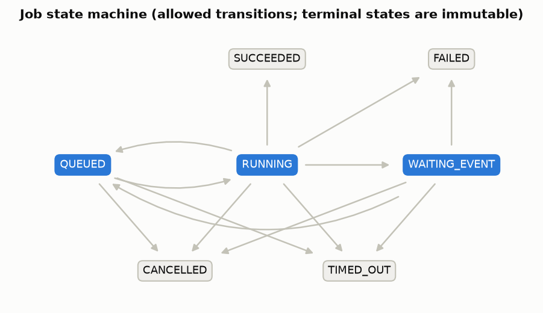
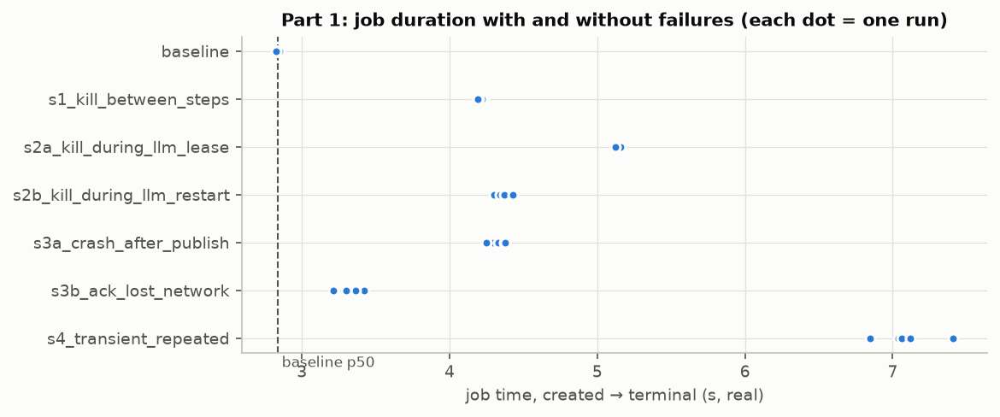
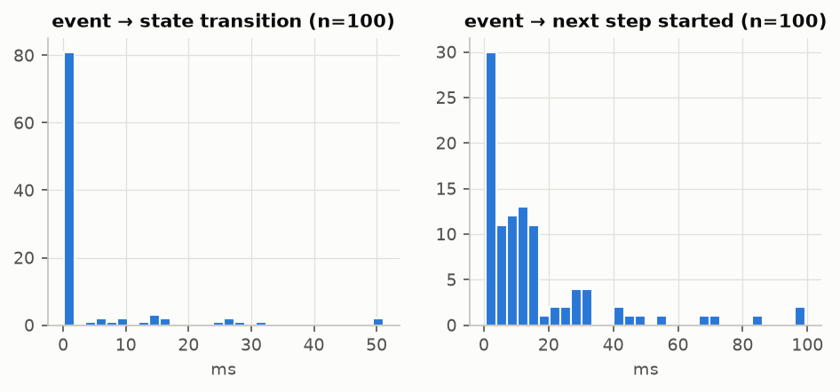
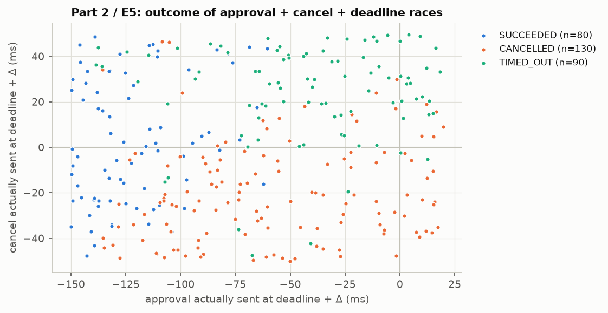
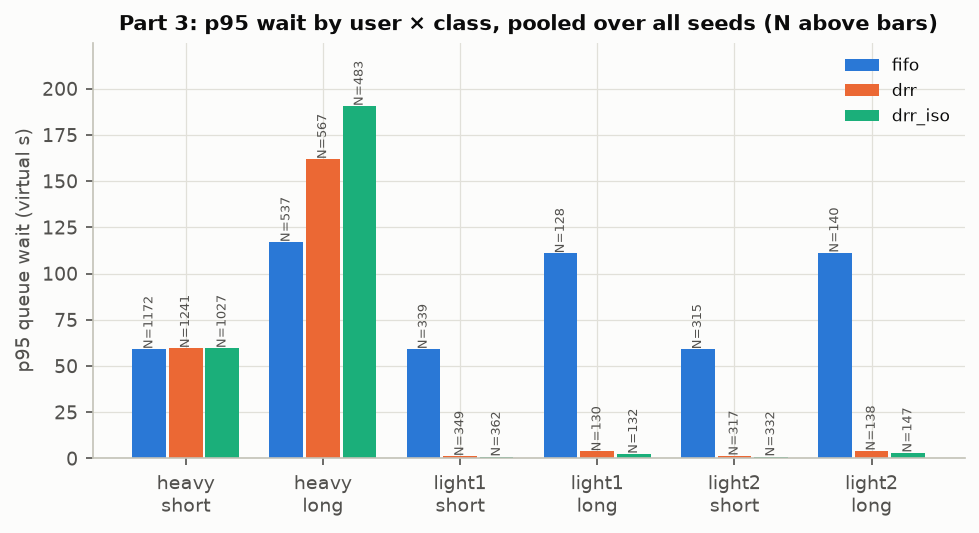
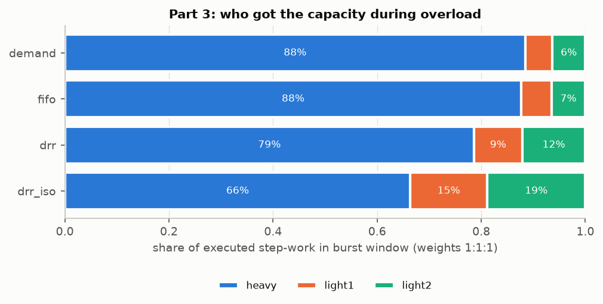
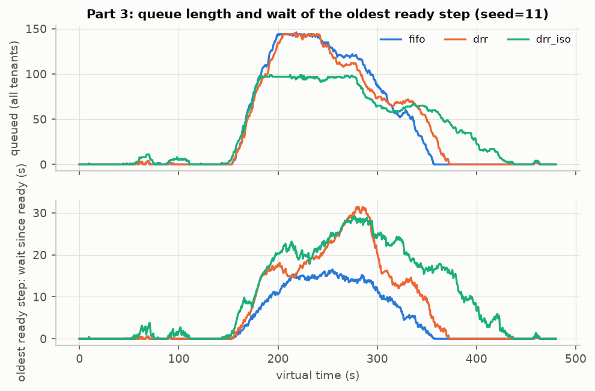
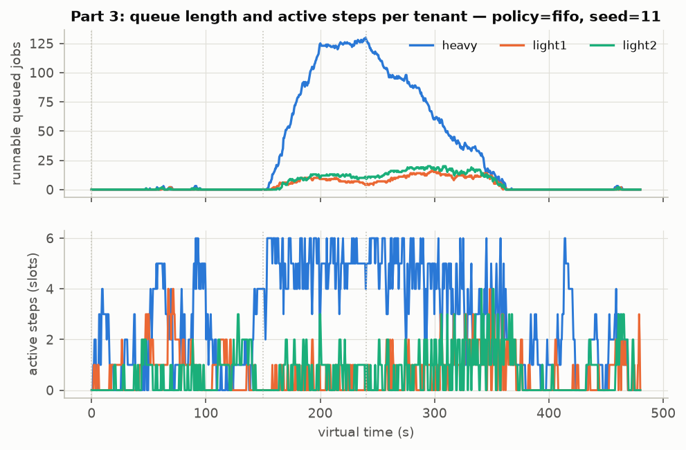
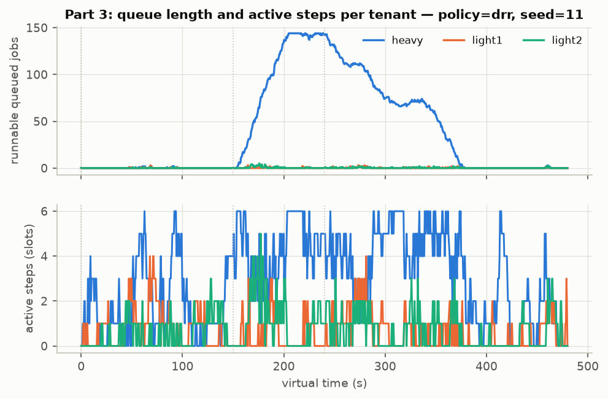
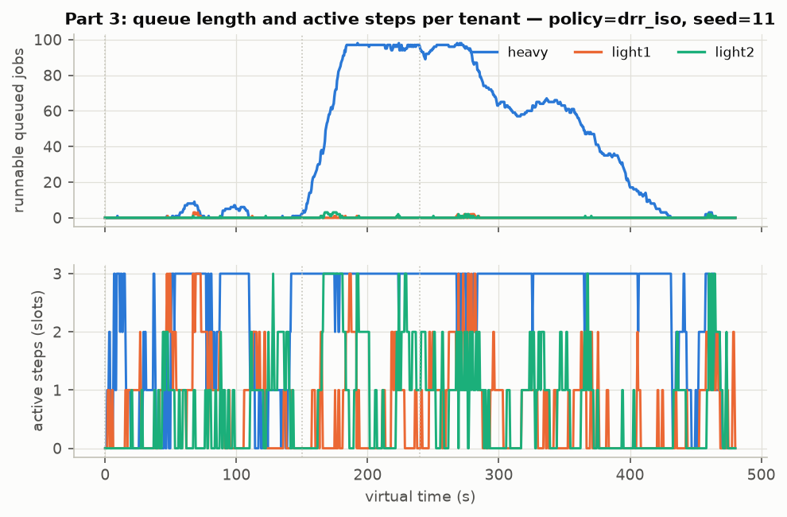

# Отчёт: durable event-driven runtime для агента-составителя отчётов

Вариант стека: **custom runtime** — Python asyncio + SQLite (WAL) как durable state store + transactional outbox +
таблицы `events`, `timers`, `scheduler`; FastAPI + CLI. Архитектура, форматы, таблица переходов, правило гонок и
обоснование выбора — в [README.md](README.md). **Все числа ниже вычислены скриптом `experiments/make_report.py`
из сырых данных `results/raw/`** (симуляция) и `results/real_llm/` (реальная LLM, если запускалась); разделы
Simulated и Real LLM не смешиваются.

## 1. Окружение

| параметр | значение |
|---|---|
| ОС | Windows-10-10.0.19045-SP0 |
| CPU | AMD64 Family 25 Model 116 Stepping 1, AuthenticAMD (16 логич. ядер) |
| RAM | 15.2 GB |
| Python | 3.13.7 |
| SQLite | 3.50.4 |
| fastapi | 0.162.0 |
| starlette | 1.10.0 |
| uvicorn | 0.54.0 |
| httpx | 0.28.1 |
| pydantic | 2.14.3 |
| pytest | 9.2.0 |
| matplotlib | 3.11.2 |
| numpy | 2.5.4 |
| Markdown | 3.11.3 |
| Масштаб времени, Part 1/2 | 1.0 (реальные секунды) |
| Масштаб времени, Part 3 | 0.1 → 1 virtual second = 0.1 real seconds |
| Seeds | Part 1: [1000, 1001, 1002, 1003, 1004]; Part 2: 7; Part 3: [11, 12, 13] (одинаковые для всех политик) |
| LLM в этих прогонах | **SimulatedLLM** (детерминированный); реальная LLM — раздел «Real LLM run» |



## 2. Автотесты

Итог: **56 passed, 1 warning in 26.06s** (полный вывод `pytest -v`: `results/pytest_output.txt`).

```
tests/test_cancel.py::test_cancel_queued PASSED                          [  1%]
tests/test_cancel.py::test_cancel_waiting PASSED                         [  3%]
tests/test_cancel.py::test_cancel_running_stops_step_and_no_new_steps PASSED [  5%]
tests/test_cancel.py::test_late_step_result_after_cancel_is_discarded PASSED [  7%]
tests/test_events.py::test_duplicate_event_applied_once PASSED           [  8%]
tests/test_events.py::test_event_in_wrong_state_is_ignored_and_logged PASSED [ 10%]
tests/test_events.py::test_stale_approval_id_is_ignored PASSED           [ 12%]
tests/test_events.py::test_approval_after_cancel_or_timeout_does_not_change_state PASSED [ 14%]
tests/test_events.py::test_rejection_revises_then_fails PASSED           [ 16%]
tests/test_events.py::test_outbox_notifies_approval_request_and_terminal_state PASSED [ 17%]
tests/test_idempotency.py::test_create_job_same_key_returns_same_job PASSED [ 19%]
tests/test_idempotency.py::test_unique_index_is_the_backstop PASSED      [ 21%]
tests/test_idempotency.py::test_concurrent_creates_with_same_key_create_one_job PASSED [ 23%]
tests/test_idempotency.py::test_publisher_dedups_by_idempotency_key PASSED [ 25%]
tests/test_idempotency.py::test_publisher_ack_lost_then_retry_returns_previous_result PASSED [ 26%]
tests/test_idempotency.py::test_http_api_create_idempotent_and_429 PASSED [ 28%]
tests/test_idempotency.py::test_http_publisher_app PASSED                [ 30%]
tests/test_llm.py::test_simulated_llm_is_deterministic PASSED            [ 32%]
tests/test_llm.py::test_openai_compatible_success_and_usage PASSED       [ 33%]
tests/test_llm.py::test_openai_compatible_error_classification[429-TransientError] PASSED [ 35%]
tests/test_llm.py::test_openai_compatible_error_classification[503-TransientError] PASSED [ 37%]
tests/test_llm.py::test_openai_compatible_error_classification[400-PermanentError] PASSED [ 39%]
tests/test_llm.py::test_openai_compatible_error_classification[401-PermanentError] PASSED [ 41%]
tests/test_llm.py::test_openai_compatible_transport_error_is_transient PASSED [ 42%]
tests/test_races.py::test_deadline_beats_approval_when_timer_not_yet_fired PASSED [ 44%]
tests/test_races.py::test_cancel_beats_deadline_when_timer_not_yet_fired PASSED [ 46%]
tests/test_races.py::test_deadline_beats_step_completion PASSED          [ 48%]
tests/test_races.py::test_randomized_races_preserve_invariants PASSED    [ 50%]
tests/test_recovery.py::test_kill_between_steps_does_not_repeat_checkpointed_steps PASSED [ 51%]
tests/test_recovery.py::test_kill_during_llm_call_is_retried_after_lease_expiry PASSED [ 53%]
tests/test_recovery.py::test_side_effect_without_ack_is_not_duplicated PASSED [ 55%]
tests/test_retry.py::test_repeated_transient_error_bounded_then_failed PASSED [ 57%]
tests/test_retry.py::test_transient_then_success PASSED                  [ 58%]
tests/test_retry.py::test_permanent_error_fails_immediately PASSED       [ 60%]
tests/test_retry.py::test_token_budget_and_max_steps PASSED              [ 62%]
tests/test_retry.py::test_backoff_equal_jitter_bounds PASSED             [ 64%]
tests/test_retry.py::test_lease_loss_counts_as_attempt_poison_pill PASSED [ 66%]
tests/test_scheduling.py::test_global_and_per_tenant_limits_never_exceeded[fifo] PASSED [ 67%]
tests/test_scheduling.py::test_global_and_per_tenant_limits_never_exceeded[drr] PASSED [ 69%]
tests/test_scheduling.py::test_limits_hold_across_two_worker_processes_sharing_the_db PASSED [ 71%]
tests/test_scheduling.py::test_admission_control_rejects_with_reason PASSED [ 73%]
tests/test_scheduling.py::test_fifo_serves_heavy_backlog_first_drr_interleaves PASSED [ 75%]
tests/test_scheduling.py::test_aging_lets_old_low_priority_job_overtake PASSED [ 76%]
tests/test_smoke.py::test_happy_path_with_approval PASSED                [ 78%]
tests/test_states.py::test_allowed_transitions_table_matches_code PASSED [ 80%]
tests/test_states.py::test_terminal_row_cannot_be_updated_even_with_raw_sql[SUCCEEDED] PASSED [ 82%]
tests/test_states.py::test_terminal_row_cannot_be_updated_even_with_raw_sql[FAILED] PASSED [ 83%]
tests/test_states.py::test_terminal_row_cannot_be_updated_even_with_raw_sql[CANCELLED] PASSED [ 85%]
tests/test_states.py::test_terminal_row_cannot_be_updated_even_with_raw_sql[TIMED_OUT] PASSED [ 87%]
tests/test_states.py::test_invalid_transition_rejected_by_trigger PASSED [ 89%]
tests/test_states.py::test_state_change_requires_version_bump PASSED     [ 91%]
tests/test_states.py::test_cas_with_stale_version_fails PASSED           [ 92%]
tests/test_states.py::test_transition_log_written_by_trigger PASSED      [ 94%]
tests/test_timers_and_slots.py::test_deadline_in_queue_fires_after_restart PASSED [ 96%]
tests/test_timers_and_slots.py::test_deadline_while_waiting_survives_worker_restart PASSED [ 98%]
tests/test_timers_and_slots.py::test_waiting_job_does_not_occupy_execution_slot PASSED [100%]
```

**Структурированные логи.** Каждая запись — JSON с полями `job_id, step, attempt, event_id` (и `worker, tenant_id, state, data`). Пример (34 строк, один job с transient-ошибкой, дублем и поздним событием): `results/raw/sample_structured_log.jsonl`:

```
{"ts": 1794049252.336778, "level": "INFO", "logger": "agentrt.worker", "msg": "step start", "job_id": "job-3c3ddd392ad948d2", "step": "fetch_documents#0", "attempt": 1, "event_id": null, "worker": "w1:33bf457f", "tenant_id": "tenant-demo", "state": null}
{"ts": 1794049252.36013, "level": "INFO", "logger": "agentrt.worker", "msg": "step start", "job_id": "job-3c3ddd392ad948d2", "step": "extract#0", "attempt": 1, "event_id": null, "worker": "w1:33bf457f", "tenant_id": "tenant-demo", "state": null}
{"ts": 1794049252.374719, "level": "INFO", "logger": "agentrt.worker", "msg": "step start", "job_id": "job-3c3ddd392ad948d2", "step": "draft#0.0", "attempt": 1, "event_id": null, "worker": "w1:33bf457f", "tenant_id": "tenant-demo", "state": null}
{"ts": 1794049252.404182, "level": "INFO", "logger": "agentrt.store", "msg": "transition", "job_id": "job-3c3ddd392ad948d2", "step": "draft#0.0", "attempt": 1, "event_id": null, "worker": null, "tenant_id": null, "state": "QUEUED", "data": {"src": "RUNNING", "dst": "QUEUED", "reason": "transient error at draft#0.0 (attempt 1): TransientError: simulated transient LLM error (503) on draft#0.0; retry in 0.019s"}}
{"ts": 1794049252.404471, "level": "WARNING", "logger": "agentrt.worker", "msg": "step transient error -> retry", "job_id": "job-3c3ddd392ad948d2", "step": "draft#0.0", "attempt": 1, "event_id": null, "worker": null, "tenant_id": null, "state": null, "data": {"error": "simulated transient LLM error (503) on draft#0.0"}}
{"ts": 1794049252.435395, "level": "INFO", "logger": "agentrt.worker", "msg": "step start", "job_id": "job-3c3ddd392ad948d2", "step": "draft#0.0", "attempt": 2, "event_id": null, "worker": "w1:33bf457f", "tenant_id": "tenant-demo", "state": null}
```

## 3. Part 1 — восстановление и идемпотентность (Simulated)

**Время** (реальные секунды; «возобновление» = первый шаг job после рестарта):

| сценарий | N | итог | время job p50 [min–max] | + к baseline p50 | старт процесса → воркер готов p50 | воркер готов → возобновление p50 | старт процесса → возобновление p50 |
|---|---|---|---|---|---|---|---|
| без отказов (baseline) | 5 | SUCCEEDED: 5 | 2.86 [2.84–2.88] | – | – | – | – |
| 1. kill между шагами (после extract) | 5 | SUCCEEDED: 5 | 4.49 [4.47–5.03] | 1.63 | 1.41 | 0.000 | 1.41 |
| 2a. kill во время LLM, другой воркер ждёт lease | 5 | SUCCEEDED: 5 | 5.21 [5.19–5.32] | 2.35 | 1.43 | 0.615 | 2.05 |
| 2b. kill во время LLM, рестарт того же воркера | 5 | SUCCEEDED: 5 | 4.75 [4.59–5.23] | 1.88 | 1.58 | 0.000 | 1.58 |
| 3a. крэш после publish (ack не сохранён) | 5 | SUCCEEDED: 5 | 4.57 [4.50–5.02] | 1.70 | 1.53 | 0.000 | 1.53 |
| 3b. ack потерян в сети (503 после коммита) | 5 | SUCCEEDED: 5 | 3.44 [3.35–3.66] | 0.57 | – | – | – |
| 4. повторяющаяся transient-ошибка | 5 | FAILED: 5 | 7.40 [7.09–7.66] | 4.54 | – | – | – |

**Повторы и побочные эффекты** (суммы по N прогонам):

| сценарий | LLM-вызовов | повторных LLM | повторных tool | вызовов с неизвестным исходом | перевыполнено шагов с чекпоинтом | publish физ. / лог. | дублей лог. публикаций | доп. токены: факт / верхняя граница | доп. стоимость USD: факт / верх. |
|---|---|---|---|---|---|---|---|---|---|
| без отказов (baseline) | 10 | 0 | 0 | 0 | 0 | 5 / 5 | 0 | 0 / ≤0 | 0.000000 / ≤0.000000 |
| 1. kill между шагами (после extract) | 10 | 0 | 0 | 0 | 0 | 5 / 5 | 0 | 0 / ≤0 | 0.000000 / ≤0.000000 |
| 2a. kill во время LLM, другой воркер ждёт lease | 15 | 5 | 0 | 5 | 0 | 5 / 5 | 0 | 0 / ≤1498 | 0.000000 / ≤0.000675 |
| 2b. kill во время LLM, рестарт того же воркера | 15 | 5 | 0 | 5 | 0 | 5 / 5 | 0 | 0 / ≤1498 | 0.000000 / ≤0.000675 |
| 3a. крэш после publish (ack не сохранён) | 10 | 0 | 0 | 0 | 0 | 10 / 5 | 0 | 0 / ≤0 | 0.000000 / ≤0.000000 |
| 3b. ack потерян в сети (503 после коммита) | 10 | 0 | 0 | 0 | 0 | 10 / 5 | 0 | 0 / ≤0 | 0.000000 / ≤0.000000 |
| 4. повторяющаяся transient-ошибка | 20 | 15 | 0 | 0 | 0 | 0 / 0 | 0 | 0 / ≤0 | 0.000000 / ≤0.000000 |

Конфигурация: lease_timeout = 2.0 с, heartbeat = 0.25 с, max_attempts = 4, backoff base = 0.5 с, cap = 4.0 с; по 5 повторов на сценарий; воркер — отдельный процесс, убивается `Popen.kill()` (на Windows это `TerminateProcess` — аналог SIGKILL: без обработчиков и `finally`), FakePublisherService — отдельный HTTP-процесс. Сырые данные: `results/raw/recovery_runs.csv`, `recovery_step_runs.jsonl`, `recovery_calls.jsonl`.



**Наблюдения (из таблицы):**

* **Kill между шагами.** Повторных LLM/tool вызовов: 0/0, перевыполненных шагов с чекпоинтом: 0. Шаги `fetch_documents`/`extract`, чей результат уже в `step_results`, не повторялись. Возобновление после того, как новый процесс готов: p50 = 0.000 с (тот же `--name` ⇒ lease прежней инкарнации забирается сразу при старте); основная часть времени «от старта процесса» (p50 1.41 с) — запуск интерпретатора и импорт модулей.
* **Kill во время LLM-вызова.** Каждый прерванный вызов повторён ровно один раз (повторных LLM: 5 на 5 прогонов в 2a и 5 на 5 в 2b). Если подхватывает *другой* воркер, он ждёт истечения lease: возобновление через 0.61 с после его готовности (остаток lease_timeout), против 0.000 с при рестарте того же воркера. **Неопределённость исхода:** 10 вызовов остались в журнале вызовов без завершения — рантайм не знает, обработал ли их провайдер и выставил ли счёт. Поэтому дополнительные токены даны интервалом: фактически оплаченные повторы, которые мы видим, = 0, верхняя граница (prompt + max_output_tokens прерванных вызовов) = 2996 токенов на 10 прогонов.
* **Side effect без ack.** В 3a процесс умирает сразу после ответа сервиса (до чекпоинта), в 3b сервис коммитит и отвечает 503. В обоих случаях физических запросов публикации 2 на job, логических — 1, дублей логических публикаций 0: повтор идёт с тем же `Idempotency-Key`, и сервис возвращает прежний `publication_id` (`replayed=true`).
* **Повторяющаяся transient-ошибка.** Ровно 4 попытки на прогон (всего 20 неудачных попыток в 5 прогонах), паузы между попытками (с, по прогонам): [0.47, 0.65, 1.49]; [0.48, 0.52, 1.74]; [0.25, 0.65, 1.33]; [0.49, 0.63, 1.27]; [0.35, 0.99, 1.46] — растут экспоненциально с jitter (ожидаемые интервалы [0.25–0.5], [0.5–1.0], [1.0–2.0] плюс время поллинга). Итог — `FAILED` с причиной: `step draft#0.0 failed after 4 attempts (max_attempts=4); last error: TransientError: simulated transient LLM error (503) on draft#0.0`.

## 4. Part 2 — событийный жизненный цикл (Simulated)

Все эксперименты — `time_scale = 1.0`, воркер в отдельном потоке (E1–E5, E7) или отдельном процессе (E6). Латентности измерены по меткам времени, записанным в БД в момент коммита (`events.received_at`, `transitions.ts`, `step_runs.started_at`). Сырые данные: `results/raw/events_*.csv`, `events_summary.json`.

### E1. Approval вовремя

100 job, итог: SUCCEEDED: 100; исходы событий: applied: 100.

| метрика | N | p50, мс | p95, мс | max, мс |
|---|---|---|---|---|
| event_to_transition_ms | 100 | 0.12 | 27.06 | 51.10 |
| client_roundtrip_ms | 100 | 0.48 | 27.35 | 51.50 |
| event_to_next_step_start_ms | 100 | 9.98 | 56.99 | 99.49 |

«event → state transition» — от приёма события до коммита перехода `WAITING_EVENT → QUEUED` (inbox и переход в одной транзакции). «event → next step started» дополнительно включает ожидание цикла планировщика (поллинг `poll_interval_s = 3 мс`, межпроцессного уведомления нет). Медиана — доли миллисекунды, а хвост (p95/max) — по всей видимости ожидание блокировки записи: если в этот момент транзакцию держит воркер, `BEGIN IMMEDIATE` отправителя попадает в busy-handler SQLite, который ждёт ступенями (1, 2, 5, 10, 15, 20, 25… мс). Это плата за single-writer хранилище.



### E2. Approval не пришёл → TIMED_OUT

40 job с дедлайном 0.5 с: итог TIMED_OUT: 40. Запаздывание перехода относительно дедлайна: p50 = 3.996 мс, p95 = 6.581 мс, max = 6.909 мс (N = 40). Шагов, исполнявшихся во время ожидания: 0.

### E3. Дубли события

Отправлено 250 копий approval (на каждую job — 3 одновременно из разных потоков и 2 повторно позже, все с одним `event_id`): применено 50, распознано как дубли 200; job с более чем одним переходом `WAITING_EVENT → QUEUED`: 0.

### E4. Approval после CANCELLED / TIMED_OUT

40 поздних событий: исходы ignored_terminal: 40; повторный cancel: already_terminal: 40; изменилось состояние: 0, изменилась версия строки: 0.

### E5. Почти одновременные approval + cancel + deadline + завершение шагов

300 повторов. Для каждой job дедлайн T = создание + 0.6 с; approval отправляется в T + U(−150, +20) мс, cancel — в T + U(−60, +60) мс (seed 7); после approval воркер исполняет `save_report` и `publish` (~30–50 мс), так что их завершение тоже попадает в окно гонки. Плановые сдвиги и фактические моменты отправки (`approve_sent_ms`, `cancel_sent_ms` — по часам отправителя перед вызовом) записаны в `events_e5_races.csv`; на графике — фактические (они могут отличаться от плановых из-за планирования потоков ОС и ожидания блокировки записи; если job ещё не дошла до `WAITING_EVENT`, отправитель ждёт её, поэтому часть событий уходит позже дедлайна).

| итоговое состояние | N |
|---|---|
| CANCELLED | 123 |
| SUCCEEDED | 99 |
| TIMED_OUT | 78 |

Откуда пришли в терминал: QUEUED->CANCELLED: 18, QUEUED->TIMED_OUT: 9, RUNNING->CANCELLED: 66, RUNNING->SUCCEEDED: 99, RUNNING->TIMED_OUT: 48, WAITING_EVENT->CANCELLED: 39, WAITING_EVENT->TIMED_OUT: 21. Исходы approval: applied: 240, deadline_won: 12, ignored_terminal: 48. Исходы cancel: already_terminal: 177, cancelled: 123. Счётчики рантайма: cancel_after_terminal: 177, events_late: 48, late_results_discarded: 62.

Инварианты: job с ≠1 терминальным переходом — 0; публикаций, принадлежащих не-SUCCEEDED job и не отозванных — 0; SUCCEEDED без живой публикации — 0; публикаций, отозванных компенсацией — 54; попыток недопустимого перехода, отклонённых триггером — 0.



Картина соответствует правилу: cancel, закоммиченный раньше дедлайна и раньше завершения `publish`, даёт CANCELLED; если approval пришёл достаточно рано, шаги успевают закоммитить SUCCEEDED, и более поздние cancel получают `already_terminal`; если к моменту approval или коммита шага дедлайн уже прошёл, побеждает TIMED_OUT (`deadline_won`, `aborted_deadline`, `late_results_discarded`).

### E6. Рестарт воркера во время ожидания

| вариант | повтор | итог | открытых step_runs в ожидании | состояние пока воркер мёртв | исход события | готов → первый шаг, мс | готов → терминал, мс | опоздание таймаута, мс |
|---|---|---|---|---|---|---|---|---|
| approval_while_down | 0 | SUCCEEDED | 0 | QUEUED | applied | 0.33 | 66.28 | – |
| deadline_while_down | 0 | TIMED_OUT | 0 | WAITING_EVENT | – | – | -1.03 | 1295.30 |
| approval_after_restart | 0 | SUCCEEDED | 0 | WAITING_EVENT | applied | 22.17 | 70.87 | – |
| approval_while_down | 1 | SUCCEEDED | 0 | QUEUED | applied | 0.19 | 56.63 | – |
| deadline_while_down | 1 | TIMED_OUT | 0 | WAITING_EVENT | – | – | -0.86 | 1802.92 |
| approval_after_restart | 1 | SUCCEEDED | 0 | WAITING_EVENT | applied | 9.05 | 56.65 | – |
| approval_while_down | 2 | SUCCEEDED | 0 | QUEUED | applied | 0.19 | 55.28 | – |
| deadline_while_down | 2 | TIMED_OUT | 0 | WAITING_EVENT | – | – | -1.07 | 1324.87 |
| approval_after_restart | 2 | SUCCEEDED | 0 | WAITING_EVENT | applied | 8.34 | 64.90 | – |
| approval_while_down | 3 | SUCCEEDED | 0 | QUEUED | applied | 0.19 | 53.97 | – |
| deadline_while_down | 3 | TIMED_OUT | 0 | WAITING_EVENT | – | – | -0.86 | 1282.92 |
| approval_after_restart | 3 | SUCCEEDED | 0 | WAITING_EVENT | applied | 13.42 | 70.13 | – |
| approval_while_down | 4 | SUCCEEDED | 0 | QUEUED | applied | 0.20 | 64.49 | – |
| deadline_while_down | 4 | TIMED_OUT | 0 | WAITING_EVENT | – | – | -1.07 | 1299.92 |
| approval_after_restart | 4 | SUCCEEDED | 0 | WAITING_EVENT | applied | 15.86 | 64.69 | – |

Ожидание не держит слот (0 открытых `step_runs`), событие принимается и применяется даже когда воркер мёртв (inbox в БД), а дедлайн, истёкший во время простоя, срабатывает при старте нового воркера (таймер хранится в БД). Для `deadline_while_down` «опоздание таймаута» ≈ длительность простоя — таймер не может сработать, пока нет ни одного живого воркера; отрицательное «готов → терминал» означает, что просроченный таймер сработал в процедуре старта воркера ещё до отметки готовности.

### E7. Время до реальной остановки после cancel

| отмена в состоянии | N | p50, мс | p95, мс | max, мс (QUEUED/WAITING: 0 по определению) |
|---|---|---|---|---|
| QUEUED | 15 | 0.00 | 0.00 | 0.00 |
| RUNNING | 15 | 67.29 | 107.00 | 109.67 |
| WAITING_EVENT | 15 | 0.00 | 0.00 | 0.00 |

Исходы LLM-вызовов в E7: cancelled: 15, ok: 15. В `RUNNING` остановка ограничена интервалом heartbeat (0.1 с в E7): шаг узнаёт об отмене на следующем heartbeat и прерывает LLM-вызов; в `QUEUED` и `WAITING_EVENT` исполняемой работы нет — остановка мгновенная (коммит перехода).

### Сводка инвариантов (переходы из журнала `transitions`, пишется триггером)

| эксперимент | проверено переходов | недопустимых переходов | изменений терминального статуса | разрывов версии | job с >1 терминальным переходом | журнал ≠ состояние |
|---|---|---|---|---|---|---|
| E1 | 1400 | 0 | 0 | 0 | 0 | 0 |
| E2 | 400 | 0 | 0 | 0 | 0 | 0 |
| E3 | 700 | 0 | 0 | 0 | 0 | 0 |
| E4 | 400 | 0 | 0 | 0 | 0 | 0 |
| E5 | 3787 | 0 | 0 | 0 | 0 | 0 |
| E7 | 285 | 0 | 0 | 0 | 0 | 0 |

## 5. Part 3 — backpressure и честное планирование (Simulated)

**Нагрузка.** 3 пользователя (`heavy` шлёт сильно больше остальных), 2 класса: short ≈ 1.00 c и long ≈ 9.50 c номинальной работы (long = 30% заявок; long разбит на шаги ≤ 1.5 с), 10% заявок с priority = 1. Фазы (заявок в вирт. секунду): P1_below [0–150 с): heavy 0.5/с, light1 0.2/с, light2 0.2/с; P2_burst [150–240 с): heavy 3.0/с, light1 0.2/с, light2 0.2/с; P3_recovery [240–480 с): heavy 0.3/с, light1 0.2/с, light2 0.2/с. Пуассоновские прибытия, трасса генерируется из seed и сохраняется (`results/raw/load_arrivals_seed*.csv`) — **один и тот же поток заявок для всех политик**. Ресурсы одинаковые: `global_concurrency = 6` (номинальная ёмкость ≈ 1.69 job/с), `max_queue_size = 150` (admitted QUEUED+RUNNING), дедлайны short 60 с / long 200 с. **Масштаб времени: 1 вирт. с = 0.1 реальной с** (все времена ниже — виртуальные секунды). Seeds [11, 12, 13], по одному прогону каждой политики на seed.

Политики:
* `fifo` — общая очередь по `ready_at`, без лимита на tenant (`per_tenant_concurrency = global`);
* `drr` — deficit round robin по tenant (веса 1:1:1, quantum 1 вирт. с работы) + aging приоритетов (+1 за 10 с ожидания), без жёсткого лимита на tenant (work-conserving);
* `drr_iso` — `drr` + `per_tenant_concurrency = 3` + квота очереди `max_queue_per_tenant = 100` (жёсткая изоляция).

### Ожидание по user × class (ожидание = суммарное время в очереди в состоянии «готов к запуску», по всем шагам; для истёкших в очереди — до момента истечения)

| политика | user | class | N | p50 ожидания, с | p95 ожидания, с | p95 по seed (min–max) | max, с | истекло (TIMED_OUT) | e2e p50 успешных, с |
|---|---|---|---|---|---|---|---|---|---|
| fifo | heavy | short | 719 | 45.17 | 59.13 | 59.08–59.18 | 59.49 | 318 | 1.56 |
| fifo | heavy | long | 336 | 68.25 | 121.28 | 97.51–123.27 | 124.49 | 0 | 78.11 |
| fifo | light1 | short | 189 | 0.12 | 59.05 | 59.03–59.07 | 59.11 | 29 | 1.38 |
| fifo | light1 | long | 74 | 1.09 | 108.06 | 91.67–119.59 | 123.03 | 0 | 10.96 |
| fifo | light2 | short | 207 | 0.17 | 59.05 | 58.93–59.08 | 59.17 | 28 | 1.38 |
| fifo | light2 | long | 73 | 1.26 | 112.92 | 69.88–121.33 | 123.11 | 0 | 10.88 |
| drr | heavy | short | 752 | 58.95 | 59.66 | 59.17–59.67 | 60.14 | 404 | 1.42 |
| drr | heavy | long | 356 | 95.36 | 161.38 | 126.80–162.99 | 165.17 | 0 | 105.18 |
| drr | light1 | short | 191 | 0.18 | 1.29 | 0.93–1.71 | 3.75 | 0 | 1.44 |
| drr | light1 | long | 75 | 0.79 | 3.29 | 2.65–4.02 | 4.65 | 0 | 10.63 |
| drr | light2 | short | 209 | 0.16 | 1.71 | 1.02–2.55 | 5.45 | 0 | 1.45 |
| drr | light2 | long | 76 | 1.05 | 4.68 | 2.24–5.05 | 5.88 | 0 | 10.89 |
| drr_iso | heavy | short | 621 | 59.06 | 59.68 | 59.67–59.68 | 60.06 | 361 | 1.71 |
| drr_iso | heavy | long | 308 | 117.71 | 190.72 | 167.58–190.82 | 191.17 | 35 | 96.82 |
| drr_iso | light1 | short | 200 | 0.04 | 1.28 | 0.23–2.01 | 3.77 | 0 | 1.31 |
| drr_iso | light1 | long | 76 | 0.28 | 2.27 | 0.92–2.82 | 3.99 | 0 | 10.23 |
| drr_iso | light2 | short | 218 | 0.04 | 0.75 | 0.37–2.85 | 5.98 | 0 | 1.26 |
| drr_iso | light2 | long | 78 | 0.10 | 3.74 | 0.31–5.04 | 7.00 | 0 | 10.08 |



### Сводка по политикам (сумма/максимум по 3 прогонам)

| политика | прогонов | заявок | принято | отклонено (по user) | SUCCEEDED | TIMED_OUT (по user) | jobs/s (весь прогон) | jobs/s в burst | загрузка слотов в burst | max ожидание, с | max возраст старейшей в очереди, с | max длина очереди | max одновременно global / лимит | max на tenant / лимит |
|---|---|---|---|---|---|---|---|---|---|---|---|---|---|---|
| fifo | 3 | 1811 | 1598 | 213 (heavy: 184, light1: 13, light2: 16) | 1223 | 375 (heavy: 318, light1: 29, light2: 28) | 0.844 | 0.626 | 98.1% | 124.49 | 17.85 | 145 | 6 / 6 | 6 / 6 |
| drr | 3 | 1811 | 1659 | 152 (heavy: 131, light1: 10, light2: 11) | 1255 | 404 (heavy: 404) | 0.866 | 0.719 | 98.1% | 165.17 | 32.53 | 145 | 6 / 6 | 6 / 6 |
| drr_iso | 3 | 1811 | 1501 | 310 (heavy: 310) | 1105 | 396 (heavy: 396) | 0.762 | 0.581 | 74.8% | 191.17 | 31.99 | 99 | 6 / 6 | 3 / 3 |

Масштабирование времени добавляет накладные расходы: медиана (фактическая − номинальная длительность шага) = 0.027 вирт. с, p95 = 0.159 вирт. с (транзакции SQLite и цикл asyncio в реальном времени не масштабируются).

### Доля выполненной работы во время перегрузки (окно burst 150–240 с, все seed)

|  | heavy | light1 | light2 |
|---|---|---|---|
| спрос (номинальная работа заявок) | 88.5% | 5.2% | 6.4% |
| вес / квота | 33.3% | 33.3% | 33.3% |
| fifo | 87.4% | 5.8% | 6.8% |
| drr | 77.0% | 10.3% | 12.7% |
| drr_iso | 65.5% | 15.3% | 19.2% |



### Длина очереди и активные шаги во времени







### Интерпретация

* **Изоляция.** В FIFO burst пользователя `heavy` заполняет общую очередь, и короткие задачи лёгких пользователей стоят за ней — их p95 ожидания вырастает до десятков секунд и часть их задач истекает или отклоняется. DRR выбирает следующий шаг по кругу между tenant, поэтому лёгкие пользователи, чей спрос ниже их доли (33 %), получают всё, что просят, а перегрузка ложится на виновника:
  * light1: short p95 59.05 → 1.29 с, long p95 108.06 → 3.29 с (FIFO → DRR);
  * light2: short p95 59.05 → 1.71 с, long p95 112.92 → 4.68 с (FIFO → DRR);
  * heavy: short p95 59.13 → 59.66 с, long p95 121.28 → 161.38 с.
* **Throughput vs latency vs isolation.** `fifo` и `drr` work-conserving: загрузка слотов в burst 98.1% и 98.1%, общий throughput близок (jobs/s), DRR лишь перераспределяет ожидание (и истечения) в сторону виновника перегрузки; число успешных job у DRR даже немного выше, т.к. короткие задачи лёгких пользователей не истекают. `drr_iso` не даёт `heavy` занять больше 3 из 6 слотов даже когда остальные простаивают: загрузка слотов в burst 74.8%, throughput в burst 0.581 против 0.719 job/с у `drr` — плата за гарантированный запас ёмкости и за то, что лёгкие пользователи вообще не получают отказов (все 310 отказов `drr_iso` — у `heavy`). Квота очереди на tenant дополнительно защищает лёгких пользователей от отказов `queue_full`, которые в `fifo`/`drr` вызывает чужой burst (общий `max_queue_size`).
* **Чтение таблиц.** p95 ожидания `heavy` short ≈ 59–60 с во всех политиках — это цензурирование дедлайном 60 с (задачи истекают в очереди, см. TIMED_OUT); «e2e p50 успешных» считается только по выжившим задачам (survivorship), поэтому у `heavy` он мал при большом ожидании. «Возраст старейшей задачи» у DRR больше, чем у FIFO: FIFO старит всех одинаково, DRR намеренно держит в очереди именно backlog `heavy`.
* **Длительная перегрузка.** Admission control ограничивает очередь (429/REJECTED с причиной), дедлайны вычищают то, что всё равно не успеет (TIMED_OUT в очереди), поэтому очередь и возраст старейшей задачи ограничены сверху, а не растут бесконечно; после окончания burst очередь рассасывается (фаза P3).
* **Планирование на границах шагов.** Слот освобождается после каждого шага (≤ 1.5 с у long), поэтому короткая задача ждёт не всю 10-секундную job, а максимум один шаг; цена — лишняя транзакция claim/complete на каждый шаг (см. накладные расходы выше).
* **Aging.** Внутри tenant priority = 1 обгоняет priority = 0, но задача с низким приоритетом, прождавшая 10 с, получает +1 и не голодает (`tests/test_scheduling.py::test_aging_lets_old_low_priority_job_overtake`).
* **Лимиты.** По трассе `step_runs` (интервалы исполнения) максимальная одновременность ни разу не превысила global/per-tenant лимит (столбцы «max … / лимит»; то же проверяют автотесты).
* **Ожидание approval не занимает слоты** — подтверждено автотестом `tests/test_timers_and_slots.py::test_waiting_job_does_not_occupy_execution_slot` (при `global_concurrency=1` вторая job полностью выполняется, пока первая ждёт approval) и E2/E6 (0 открытых `step_runs` в ожидании).

## 6. Real LLM vs Simulated

### Simulated (данные этого отчёта)

| метрика | SimulatedLLM |
|---|---|
| LLM-вызовов на job (baseline) | 2.0 |
| токенов на job (prompt+completion) | 345.8 |
| стоимость на job, USD (иллюстративная цена из конфига) | 0.000118 |
| латентность LLM-вызова | задана конфигом: 1.0 с (Part 1) |
| время job baseline p50, с | 2.86 |

### Real LLM run

> **Статус: ЗАПУЩЕН** (данные из `results/real_llm/`, не смешиваются с симуляцией).

| метрика | Real LLM |
|---|---|
| модель / endpoint | qwen3.5:4b / http://localhost:11434/v1 |
| job: итог | SUCCEEDED: 1 |
| LLM-вызовов (ok / всего) | 6 / 6 |
| латентность LLM-вызова p50 / max, с | 27.88 / 33.39 |
| токенов prompt / completion | 702 / 919 |
| стоимость, USD | 0.000657 |
| kill во время LLM: повторных вызовов / доп. токены (факт / верх.) | 1 / 0 / ≤299 |
| крэш после publish: физ./лог. публикаций | 2 / 1 |

Чем реальная LLM отличается от симулятора (ожидаемо, проверить по таблице): латентность и токены не детерминированы; ошибки 429/5xx/таймауты классифицируются как transient и ретраятся; прерванный крэшем вызов почти наверняка оплачен провайдером (верхняя граница доп. токенов становится реальной ценой); текст черновика при повторе может отличаться, но это не ломает идемпотентность публикации — тело собирается из *сохранённых* результатов шагов, а повтор `draft` после чекпоинта невозможен.

## 7. Ответы на вопросы задания

**1. Где хранится состояние?** В одном файле SQLite (WAL) рантайма: `jobs` (состояние, версия, lease,
следующий шаг, счётчики), `step_results` (чекпоинты шагов), `events`/`event_receipts` (inbox), `outbox`,
`timers` (дедлайны), `scheduler` (DRR), `transitions` (журнал, пишется триггером), `step_runs` (трасса
исполнения и занятые слоты). В памяти воркера нет ничего, что нельзя потерять: после SIGKILL всё
восстанавливается из БД. Внешний сервис публикаций хранит свои публикации в своей БД.

**2. Что при сбое между обновлением состояния и публикацией следующего события?** Такого окна нет:
обновление состояния и запись сообщения в `outbox` (`approval.requested`, `job.<terminal>`) — одна
транзакция; следующий шаг тоже не «событие в брокере», а поле `next_step` в той же строке. Если процесс
упал после коммита, но до доставки, relay при рестарте найдёт строку `delivered_at IS NULL` и доставит её
(at-least-once); получатель дедуплицирует по `message_id` (`Idempotency-Key`). Если упал до коммита —
не было ни нового состояния, ни сообщения; шаг повторится после истечения lease.

**3. Какие операции могут повторяться и как ограничены последствия?** Повторяется только незакоммиченная
попытка шага: LLM-вызов, tool-вызов, publish, а также доставка outbox. Ограничения: (а) чекпоинт — шаг с
сохранённым результатом не перевыполняется; (б) `max_attempts` на шаг (крэш тоже считается попыткой —
защита от poison pill), backoff с jitter, `step_timeout`, `max_steps`, `max_tokens`; (в) внешний side effect
идемпотентен (`Idempotency-Key`), поэтому повтор publish даёт 0 дублей логических публикаций; (г) повтор
LLM стоит денег — измерено как доп. вызовы/токены (Part 1), с верхней границей для вызовов с неизвестным
исходом; (д) фенсинг по `lease_token` не даёт «зомби»-воркеру закоммитить поздний результат.

**4. Как разрешаются гонки cancel / deadline / completion?** Побеждает первая закоммиченная транзакция
перехода в терминальное состояние (SQLite сериализует писателей, переход — CAS по `version` с
`state NOT IN terminal`, триггер запрещает менять терминальные строки). При «одновременности» действует
приоритет CANCELLED > TIMED_OUT > approval > step completion: cancel не проверяет дедлайн; approval и коммит
шага проверяют `now ≥ deadline` и вместо себя коммитят TIMED_OUT; коммит шага фенсится lease. Поздние
результаты отбрасываются, поздние события получают `ignored_terminal`. Если publish успел пройти, а job
отменена/истекла, выполняется компенсация (retract публикации). E5: 0 нарушений инвариантов на всех повторах.

**5. Что обеспечивает справедливость и что при длительной перегрузке?** DRR по tenant на границах шагов
(веса, quantum в секундах работы) + aging внутри tenant; опционально жёсткие per-tenant лимиты слотов и
квоты очереди. При длительной перегрузке очередь ограничена admission control (429/REJECTED с причиной и
метрикой), дедлайны снимают задачи, которые не успеют (TIMED_OUT, в т.ч. из очереди), DRR не даёт одному
tenant вытеснить остальных; throughput остаётся равным ёмкости (work-conserving), а отказы и истечения
концентрируются у tenant-источника перегрузки (Part 3).

**6. Какие гарантии от инфраструктуры, а какие из кода?** Инфраструктура (SQLite): атомарность,
сериализуемость писателей, долговечность коммита (WAL), уникальные индексы и триггеры. Код: модель
состояний и CAS, lease/heartbeat/reaper/recovery, фенсинг, ретраи и классификация ошибок, дедуп событий
(через PK), outbox relay, durable-таймеры, admission control, планировщик, компенсация, идемпотентный
ключ публикации. Внешний сервис отвечает за собственную дедупликацию по ключу. Подробная таблица — README,
раздел «Гарантии инфраструктуры vs кода приложения».

## 8. Ограничения и честные оговорки

* **Real LLM не запускалась** в среде подготовки (нет ключа/локальной модели) — все числа в отчёте получены с
  `SimulatedLLM`; раздел «Real LLM run» помечен и заполняется после `scripts/run_real_llm.*`. Код
  `OpenAICompatibleLLM` проверен только против mock-транспорта (`tests/test_llm.py`), не против настоящего API.
* **Один узел, один писатель.** SQLite сериализует все записи; масштабирование — несколько процессов на одной
  машине (лимиты проверяются в транзакции и для них верны), но не кластер. Узкое место — частота транзакций
  (claim + complete на каждый шаг + heartbeats).
* **Windows вместо Linux.** Эксперименты выполнены на Windows 10: «SIGKILL» реализован как
  `Popen.kill()` → `TerminateProcess` (те же свойства: без обработчиков/`finally`). На POSIX тот же код
  посылает SIGKILL, но там прогон не выполнялся.
* **`synchronous=NORMAL`**: гарантия durable — против падения процесса (это и проверялось), но не против
  потери питания/краха ОС для последних транзакций (`AGENTRT_SYNC=FULL` закрывает это ценой латентности; не измерялось).
* **Масштабированное время** в Part 3 (1 вирт. с = 0.1 с): накладные расходы рантайма (транзакции, поллинг)
  не масштабируются и в вирт. секундах выглядят больше (оценка приведена). Абсолютные значения — для этой
  машины и этого масштаба; сравнение политик корректно, т.к. условия одинаковые.
* **Статистика.** Part 1: 5 повторов на сценарий; Part 3: 3 прогона на политику — разброс p95 по seed показан,
  доверительные интервалы не считались. Для `light*`×`long` число наблюдений невелико (см. N в таблице).
* **Неопределённость внешних вызовов** не устранима на стороне клиента: прерванный LLM-вызов может быть
  оплачен; мы даём верхнюю оценку (prompt + max_output_tokens), а не точное значение.
* **Окно публикации при cancel.** Отмена во время `publish` не может «отозвать» уже отправленный запрос;
  инвариант обеспечивается компенсацией (retract) после факта, т.е. публикация может кратко существовать.
* **Цены токенов** в конфиге иллюстративные (не прайс-лист провайдера); стоимость = токены × цена из конфига.
* **Межпроцессных уведомлений нет**: воркер узнаёт о новых событиях/заявках из других процессов поллингом
  (`poll_interval_s`), это входит в латентность «event → next step».
* `docker-compose.yml` приложен как опция и в отчётных прогонах не использовался.
* Политика агента (`decide`) — детерминированные правила с ограничениями (min_docs, max_tool_calls, approval),
  а не решение LLM; LLM используется для черновика.

